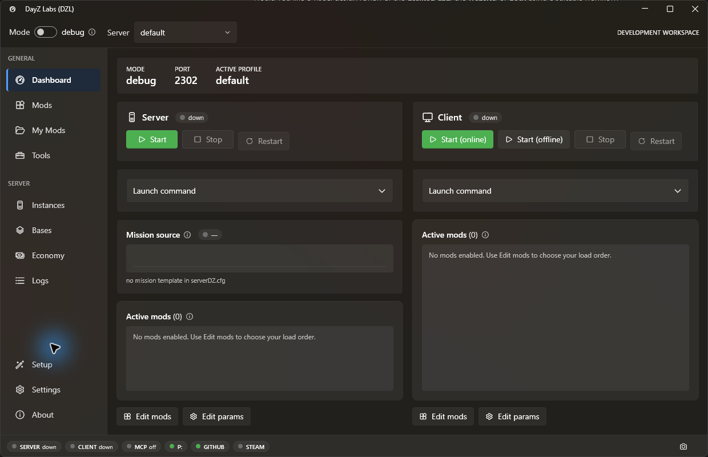

# DayZ Labs — Smith2912 fork

This is **[Smith2912/dayz-labs](https://github.com/Smith2912/dayz-labs)**, maintained by
**The Songsmith** for independent development, based on
[Borcioo/dayz-labs](https://github.com/Borcioo/dayz-labs). Changes are maintained in this
fork and are not automatically submitted to the upstream project.

`dzl` is a DayZ mod-development launcher for Windows. It starts and stops the DayZ dev server and
client, manages an ordered mod selection plus named config presets, tails and diagnoses the DayZ
logs, and wraps the DayZ Tools — Addon Builder, ImageToPAA, CfgConvert, the **P:** work drive, and
more. On top of that it adds a validating build pipeline, Central Economy editors, Steam Workshop
downloads, and git/GitHub integration. One engine ships three ways: a CLI, an MCP server (so an AI
agent like Claude can drive it), and a WPF system-tray app.



## Changes in this fork

- **Mission ownership:** bind economy edits and undo to the loaded mission, reject stale
  writes, preserve dirty Types drafts across window closure, and guard instance changes.
- **Recovery:** persist empty Types files, stop writes when backups fail, retain recovery
  points during restore, and preserve invalid configuration bytes instead of resetting them.
- **Process and automation ownership:** scope IPC, locks, and process state to each config;
  validate process creation time and executable path; retain unknown ownership records;
  serialize lifecycle changes and reserve state before launching a process.
- **Safer operations:** validate server purge targets, update configuration atomically,
  merge setup settings, and own extraction cancellation and destination selection.
- **Build correctness:** include effective prefixes and tool/key inputs in cache checks,
  verify cached artifact hashes, share pack exclusions, and register cached builds with
  the active instance.
- **Desktop design:** expandable launch details, wrapping client actions, scrollable
  dashboards, clearer empty states, and visible navigation/table keyboard focus.
- **Website design:** task-oriented guides, responsive layouts, an updated app image,
  and explicit fork/upstream release guidance.

The follow-up blindspot fixes also reject duplicate Type names, retain usable revisions
after partial saves, guard restore against dirty drafts, and bind dictionary sessions.
Tray monitor launches preserve the selected config, canonical aliases share ownership
storage, and successful de-elevated starts are not retried as elevated processes.
Build staging is unique per invocation; completed archives undergo structure, prefix,
payload-length and container-checksum verification. Extraction receipts include output
digests, and **Verify / repair** forces re-extraction of unchanged source PBOs.

## Builds and release status

Check this fork's [releases](https://github.com/Smith2912/dayz-labs/releases) for independently published builds. The original project's releases remain available from [Borcioo/dayz-labs](https://github.com/Borcioo/dayz-labs/releases).

- Source builds are the basis of this fork's current validation. Installer and update
  behavior have not been qualified for an independent fork release.
- **Automatic updates are disabled in this fork** until its package identity and update channel are configured and qualified.
- The inherited Velopack packaging supports per-user, self-contained installers.
  Check each published release's notes for signing and scan status; packaging support
  is not evidence that a fork installer has passed acceptance checks.
- Publication is gated by the `DZL_RELEASE_REPOSITORY` repository variable matching
  `github.repository`. A tag alone does not publish an unconfigured fork.

On first launch (no config yet) a **setup wizard** runs: it detects DayZ + DayZ Tools, mounts the P:
work drive, extracts vanilla game data, sets your **project folder** (where mods, builds, server
instances, and keys live), and scaffolds a server instance.

## Requirements

- **Windows 10 or 11** for the desktop app.
- **DayZ** and **DayZ Tools**, both installed via Steam — they provide Addon Builder, ImageToPAA,
  CfgConvert, the WorkDrive, etc.
- Optional, per feature: **steamcmd** (Workshop downloads), the **GitHub CLI** (`gh`, for publishing
  repos / cutting releases), and a **Steam Web API key** (Workshop search).

## What it does

- **Server / client lifecycle** — start, stop, restart the dev server and client in `debug` (DayZDiag
  from the game install) or `normal` (`DayZServer_x64.exe` from the separate DayZ Server install).
  Process records include executable path and creation time; unknown ownership blocks
  destructive actions until resolved.
- **Ordered mods + named presets** — an ordered mod selection where each mod is tagged
  `both` / `server` / `client` (server-only mods go to `-serverMod`, the rest to `-mod`). Full config
  snapshots are saved as named presets you can switch between.
- **Log tailing + diagnosis** — read the last N lines of any DayZ log, and run a diagnoser that
  pattern-matches known failure signatures (verification kicks such as `VE_MISSING_BISIGN` /
  `VE_PATCHED_PBO`, mod version skew, build-tool symptoms) into cause → fix entries.
- **DayZ Tools wrappers** — discover and launch the DayZ Tools GUIs, batch-convert textures to PAA,
  pack folders into PBOs, and unbinarize configs. Mount / unmount the **P:** work drive without opening
  the Tools GUI.
- **Build pipeline** — build a mod project into a PBO with a preflight gate (config sanity,
  missing/excluded asset references, baked absolute paths, path-hygiene rules, Enforce-script traps),
  optional binarization and signing, a content-hash cache for non-binarized builds, and
  archive structure/checksum verification. Binarized builds always rebuild until external
  P: assets and includes can be tracked reliably. Container checks do not verify BI signatures.
- **Signing keys** — create your creator key pair once; one key signs all your mods.
- **Central Economy editors** — edit a mission's `types.xml` and the rest of the CE config (events,
  globals, spawnable types, random presets, player spawns) with linting and versioned backups.
- **Steam Workshop** — search the Workshop (Steam Web API) and download/update items via steamcmd.
- **git / GitHub integration** — treat a mod project as a git repo: status, changes, log, diff, commit,
  branches, push/pull, publish a new GitHub repo, and cut releases.
- **Three frontends, one core** — a CLI, an MCP server for AI agents, and a WPF tray app, all over the
  shared `Dzl.Core` engine.

## Documentation

This fork's guides live in [`web/src/content/docs/`](web/src/content/docs/). Start with
the [setup guide](web/src/content/docs/guides/getting-started.md). Preview the Astro site
with Node.js 22 and npm:

```powershell
cd web
npm ci
npm run dev
```

Open the local URL Astro prints, including `/dayz-labs/`. For a production preview,
run `npm run build` and then `npm run preview`.

The inherited hosting configuration still names the upstream GitHub Pages site; a hosted
fork URL has not been qualified. [Upstream documentation](https://borcioo.github.io/dayz-labs/)
describes that project's version and may differ from this fork.

## Drive it from an AI agent (MCP)

`dzl` ships an MCP server, so an MCP client such as Claude can call the same operations the app does
(status, start/stop, logs, build, preflight, Central Economy edits, Workshop, git, …). Point your MCP
client at a source-built server after building the solution. Replace the absolute
checkout path below with your own:

```json
{
  "mcpServers": {
    "dzl": {
      "command": "dotnet",
      "args": [
        "run", "--no-build", "--project",
        "C:\\path\\to\\dayz-labs\\src\\Dzl.Mcp", "-c", "Debug"
      ]
    }
  }
}
```

stdout is the MCP protocol stream, so the server logs only to stderr. See the
[local MCP guide](web/src/content/docs/guides/mcp.md) for the tool catalog.

## Building from source

Use the **[.NET 8 SDK](https://dotnet.microsoft.com/download/dotnet/8.0)** on Windows.
Framework-dependent desktop builds also need the .NET 8 Desktop runtime; self-contained
builds include their runtime. To obtain and build this fork:

```powershell
git clone --branch dev https://github.com/Smith2912/dayz-labs.git
cd dayz-labs
dotnet build Dzl.sln -c Debug

.\run-dzl.bat                      # build + launch the tray, de-elevated via explorer.exe
```

Run tests sequentially because the projects share build outputs. Close the development
app before rebuilding its output:

```powershell
dotnet test tests/Dzl.Core.Tests/Dzl.Core.Tests.csproj
dotnet test tests/Dzl.Tray.Tests/Dzl.Tray.Tests.csproj -r win-x64 -p:SelfContained=true
```

The self-contained tray test command supports Windows hosts without an installed
.NET 8 Desktop runtime.

`run-dzl.bat` launches the tray **de-elevated**: the tray mounts the **P:** work drive, and a mounted
drive is only visible in the session that mounted it — so an elevated tray would mount P: where the
(non-admin) game and Explorer can't see it. Prefer this script over `dotnet run` for the tray.

A short CLI tour:

```powershell
dotnet run --project src/Dzl.Cli -- status            # launcher status
dotnet run --project src/Dzl.Cli -- start --client    # start server + client (debug)
dotnet run --project src/Dzl.Cli -- logs script --lines 100
dotnet run --project src/Dzl.Cli -- preflight MyMod   # validate before building
dotnet run --project src/Dzl.Cli -- build MyMod --sign
```

Run `dotnet run --project src/Dzl.Cli -- --help` for the full command list. The release installer is
built by `scripts/pack.ps1` (Velopack). `.github/workflows/release.yml` requires the fork's
release configuration before a `v*` tag can publish a package.

## Validation

The original remediation checks recorded October 27–29, 2026 passed **735 core tests** and **212 tray tests**,
plus isolated desktop startup and editor workflow checks. The website build and internal
link checks passed; its layouts were reviewed at mobile, tablet, and desktop widths.

Follow-up blindspot validation and its host-specific limits are recorded in
[the fix report](docs/validation/blindspot-fixes-2026-10-29.md).

These are source-build and disposable-fixture results. Native DayZ server/client behavior,
BankRev extraction, Binarize/CfgConvert output, cryptographic signature acceptance, and
installer/update/uninstall behavior remain separate acceptance checks. No installer or
public deployment was produced as part of these fixes.

## Independent development

Work in this fork targets **`dev`**. The inherited site deployment workflow targets `main`;
pushing development changes does not deploy the website or submit an upstream contribution.
The inherited `CONTRIBUTING.md` describes the original project's contribution process,
not a requirement to send this fork's changes upstream.

## License

`dzl` is licensed under the **GNU General Public License v3.0** — see [LICENSE](LICENSE).

Copyright © 2026 Borcioo (DayZ Labs).

Original attribution and license are retained. Fork maintenance and modifications:
The Songsmith / Smith2912.

## Disclaimer

DayZ Labs (`dzl`) is an unofficial, community-made tool. It is **not affiliated with,
endorsed by, or authorized by Bohemia Interactive a.s.** Bohemia Interactive, ARMA, DAYZ,
ENFUSION and all associated logos and designs are trademarks or registered trademarks of
Bohemia Interactive a.s.
